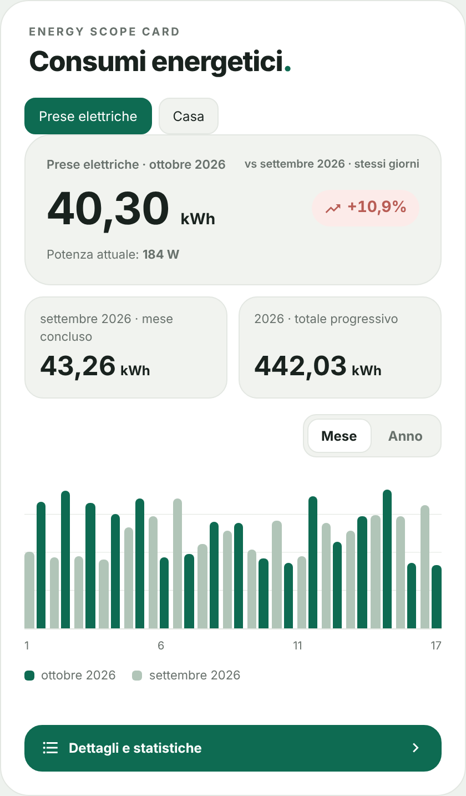
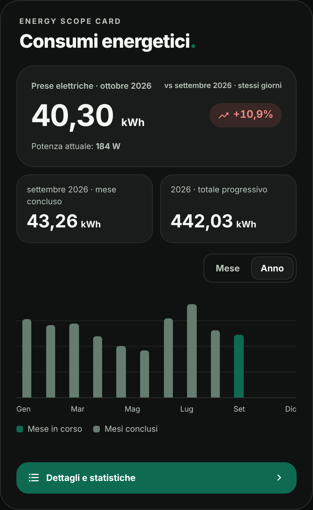
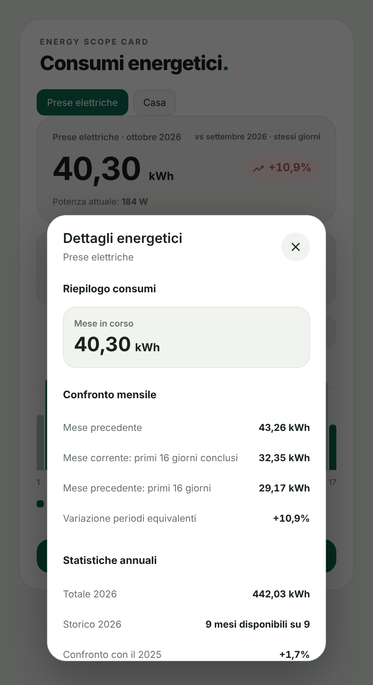

# Energy Scope Card

## Overview

**Energy Scope Card** is a modern, minimalist, and responsive energy monitoring card for Home Assistant, inspired by the Edera Light and Graphite Dark visual styles.

It provides energy consumption monitoring, daily charts, monthly comparisons, and yearly statistics through an elegant dashboard interface.

The card supports compatible monthly energy meters and cumulative energy sensors, allowing users to monitor individual circuits and whole-home electricity consumption.

Energy Scope Card uses Home Assistant entities and available local Recorder statistics. No dedicated account, paid API, subscription, or external JavaScript library is required.

## Preview

| Light | Dark |
| --- | --- |
|  |  |

*Previews use fictional demo data. The interface text is currently in Italian.*

## Features

- **Energy monitoring:** Display current monthly energy consumption in kWh.
- **Previous month:** Show the previous month's consumption when available.
- **Monthly comparisons:** Calculate percentage changes using equivalent completed calendar days.
- **Daily charts:** Visualize daily energy consumption and compare it with the previous month.
- **Yearly statistics:** Display monthly consumption throughout the year using available historical statistics.
- **Instantaneous power:** Optionally display current power consumption in watts.
- **Multiple energy sources:** Switch between separately configured energy sources, such as individual circuits and whole-home consumption.
- **Flexible sensors:** Support compatible monthly-reset energy meters and cumulative energy counters.
- **Detailed statistics:** Open a compact popup with additional energy information.
- **Visual editor:** Configure energy sensors, optional power sensors, charts, labels, and appearance directly in Home Assistant.
- **Edera appearance:** Automatic, Light, and Graphite Dark display modes.
- **Responsive design:** Adaptive layout for desktop, tablet, and smartphone dashboards.
- **Read-only monitoring:** No commands are sent to electrical devices.

Energy sources remain separate to avoid double counting. Missing historical values are not estimated, and comparisons are displayed only when sufficient data is available.

## Installation

### HACS (Recommended)

Install Energy Scope Card directly from the default HACS catalog.

1. Open **HACS** in Home Assistant.
2. Search for **Energy Scope Card**.
3. Select **Energy Scope Card** from the results.
4. Click **Download** to install the card.
5. Reload your dashboard if necessary.
6. Add **Energy Scope Card** to your dashboard and configure it using the visual editor.

To install a specific release, use **Download** or **Redownload** and select the desired version when available.

### Alternative: Custom repository

If you prefer to add the repository manually:

1. Open **HACS** and select **Custom repositories** from the menu.
2. Enter `https://github.com/luigi-regolo/energy-scope-card`.
3. Select **Dashboard** as the repository type and add it.
4. Find **Energy Scope Card** in HACS and download it.

### Manual installation

1. Download `dist/energy-scope-card.js` from this repository.
2. Copy the JavaScript file into the `www` directory of your Home Assistant configuration.
3. Open Home Assistant's dashboard resource management.
4. Add `/local/energy-scope-card.js` as a **JavaScript module**.
5. Reload the dashboard and add the custom card.

## Configuration / Usage

### Visual Editor

The card provides four configuration sections:

- **Sources:** Select energy sensors, optional power sensors, source names, and an additional whole-home energy source.
- **Charts:** Configure monthly charts, yearly statistics, percentage comparisons, and detailed information.
- **Appearance:** Customize the title, upper heading, and Edera display mode.
- **Advanced:** Configure numerical precision.

No YAML configuration is required for normal setup.

### Energy Calculations

For compatible monthly-reset meters, the current period is read directly from the sensor, while the previous period is obtained from its available attributes.

For cumulative energy sensors, period consumption is calculated using Home Assistant Recorder statistics.

Daily comparisons use equivalent completed calendar days. Yearly statistics depend on the historical data actually stored by Home Assistant.

Unavailable statistics are not replaced with estimated consumption values.

### Whole-Home Monitoring

A compatible whole-home electricity meter can be configured as an additional energy source.

The card can display its energy consumption and optional instantaneous power without combining those measurements with existing individual circuit totals.

## Compatibility / Requirements

Energy Scope Card requires Home Assistant with support for custom JavaScript dashboard cards and compatible energy sensors.

Supported energy sensors must provide:

- `device_class: energy`
- `state_class: total` or `total_increasing`
- Energy units: Wh, kWh, or MWh

Optional power sensors must provide `device_class: power` with W or kW units.

Historical charts and comparisons require suitable Recorder statistics. Their availability depends on the sensor's recorded history.

No specific minimum Home Assistant version has been independently verified.

The card does not require the Edera theme, an external cloud service, or additional frontend libraries.

## Releases

See [GitHub Releases](https://github.com/luigi-regolo/energy-scope-card/releases) for published versions.

## Copyright & License

Copyright © 2026 luigi-regolo

Original project created and maintained by luigi-regolo.

Licensed under the **GNU General Public License, version 3 only (GPL-3.0-only)**. See [LICENSE](LICENSE) for the complete license terms.
